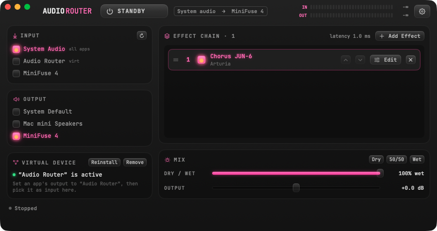
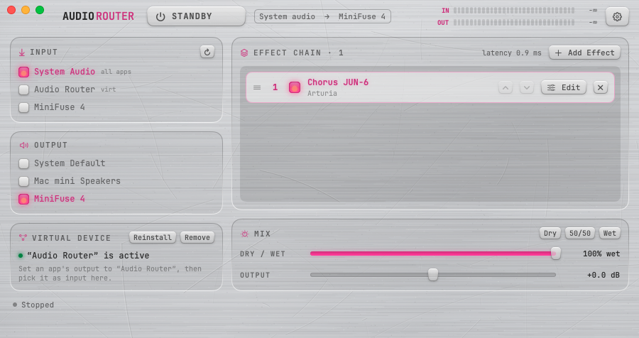

# Audio Router

A small macOS app that runs live computer audio through a chain of Audio Unit effects. You can put a reverb, EQ, compressor or any other AU plug-in on everything your Mac plays, or on just one app.

  

```
all apps ──▶ system audio tap ─┐
one app  ──▶ "Audio Router" ───┼──▶  AU 1 ▶ AU 2 ▶ …  ──▶  dry/wet mix  ──▶  speakers / interface
mic / interface input ─────────┘     (virtual device)
```

Typical uses:
- EQ or limit everything the Mac plays to suit your speakers or headphones.
- Add reverb, chorus or tape effects to a streaming app, a browser or a game.
- Process a single app by sending only its output to the virtual device.
- Try out AU plug-ins on any material without opening a DAW.

<p align="center">
  <br>
  
</p>

## Features

- **Inputs:**
  - **System Audio:** everything playing on the Mac, captured through a Core Audio process tap. The original sound is muted while it's tapped, and Audio Router's own output is excluded, so there is no feedback.
  - **Audio Router (virtual device):** a virtual output device that individual apps can play into (see [Virtual device](#virtual-device)).
  - Any other input device: a microphone, an audio interface, BlackHole, and so on.
- **Output:** System Default or a specific device. Capture is clocked from the output device through a private aggregate device with drift compensation, so input and output never drift apart.
- **Effect chain:**
  - Add any installed AU effect or music effect.
  - Reorder by dragging or with ▲/▼.
  - Bypass an effect with its checkbox, or remove it.
  - Open an effect's own UI with **Edit** or a double-click. Plug-ins without a UI get a generic parameter view.
  - The list grows with the chain and scrolls after six effects.
- **Dry/Wet mix:** blends the unprocessed signal with the processed one. The dry path is delayed by the plug-ins' reported latency, so the two stay sample-aligned and there is no comb filtering.
- **Meters and gain:** In/Out LED peak meters and an output gain control from −∞ to +6 dB.
- **Remembers everything:** the chain, each plug-in's settings, the input and output choices, and the mix are restored on the next launch.
- **Follows the system:** reacts to changes of the default output device and to devices being plugged in or unplugged.
- **Latency settings** (⌘,):
  - Sample rate, set on the output device.
  - I/O buffer size, for Audio Router only.
  - Safety buffer between capture and playback.
  - Live estimate of the total latency, with its breakdown, and a dropout counter.
- **Looks:** two skins, switched in Settings → Appearance:
  - **Dark Glass:** a frosted-glass dark UI with "rubber" keys, shared with [MIDI Filter](https://github.com/avchaykin/midi-filter).
  - **Aluminium:** a light skin on scratched, brushed anodized aluminium, with machined recessed panels.

  In both you can set the glow colour and intensity, and a backlight "bulb" (colour, shape, blur and intensity). Dark Glass also has a glass opacity setting.

## Install

There is no notarized binary yet; build it from source. It takes about a minute.

Requirements: macOS 15 or later and the Xcode **Command Line Tools** (`xcode-select --install`). Full Xcode is not needed.

```sh
git clone https://github.com/avchaykin/audio-router.git
cd audio-router
./build.sh                      # → build.nosync/Audio Router.app (release, ad-hoc signed)
open "build.nosync/Audio Router.app"
```

On first start macOS asks for permission to capture system audio. You can change it later in System Settings → Privacy & Security → Screen & System Audio Recording → *System Audio Recording Only*. Reading an input device, including the virtual device, also needs Microphone permission.

The app is ad-hoc signed, so macOS may ask for these permissions again after a rebuild. If you copy the app to another Mac, macOS may block the first launch; right-click the app → **Open**, or allow it in System Settings → Privacy & Security.

## Quick start

1. Launch Audio Router. Under **Input**, keep **System Audio**; under **Output**, pick your speakers, headphones or interface.
2. Click **Add Effect** and choose a plug-in. Click **Edit** to open its UI.
3. Press **STANDBY** to start processing. The key changes to **PROCESSING** and the meters come alive.
4. Use **Dry / Wet** to blend in the original sound, and **Output** to trim the level.

## Virtual device

`Driver/AudioRouterDriver.c` is a small Core Audio HAL plug-in (AudioServerPlugIn). It adds an **Audio Router** device whose stereo output is looped back to a stereo input, at 44.1–192 kHz. Use it to process one app instead of the whole system.

Install it from the app (**Virtual Device → Install…**, which asks for your admin password), or from the terminal:

```sh
sudo ./install-driver.sh                 # remove with: sudo ./install-driver.sh --uninstall
```

Installing restarts `coreaudiod`, so all sound stops for a moment.

Then:
1. Set an app's output to **Audio Router**, or set the Mac's output to it in System Settings → Sound.
2. In Audio Router, choose **Audio Router** as the input, and your real speakers or headphones as the output.

Audio Router won't start if its output would be the virtual device itself, since that would loop.

## Latency

Total latency is input buffer + safety buffer + output buffer + plug-in latency. It depends mostly on the I/O and safety buffers, which you set in **Settings → Audio**. Smaller buffers give lower latency but risk dropouts (clicks). The **Latency** section and the status bar show the live estimate and the dropout count.

Measured on an Arturia MiniFuse 4 at 44.1 kHz, with no dropouts:

| Setting | Estimated latency |
|---|---|
| Device default (512 in / 1024 out) | ≈ 48 ms |
| Buffer 64, auto safety | ≈ 10 ms |
| Buffer 32, safety 64 | ≈ 4 ms |

## How it works

```
process tap / input device ─▶ private aggregate device IOProc ─▶ lock-free ring buffer
    ├▶ wet source ─▶ AU 1 ─▶ AU 2 ─▶ … ─▶ wet mixer ──────────────┐
    └▶ dry source (delayed by plug-in latency) ─▶ dry mixer ──────┴▶ main mixer (gain) ─▶ output
```

- The capture IOProc writes into a single-producer, single-consumer ring buffer built on Swift `Synchronization` atomics. Nothing is allocated or locked on the audio thread.
- The engine's source nodes read from the ring at a target fill (the safety buffer). Underruns and catch-up skips are counted as dropouts.
- The dry reader is aligned to the wet reader by sample time, then delayed by the sum of the plug-ins' latency.

## Project layout

```
Sources/AudioRouter/
  App.swift                  app entry, main window and its sections
  AudioRouter.swift          engine graph, effect chain, devices, settings, persistence
  AudioCapture.swift         process tap + private aggregate device + IOProc
  RingBuffer.swift           lock-free stereo ring (wet and aligned dry readers)
  CoreAudioUtils.swift       Core Audio device helpers
  PluginWindowManager.swift  plug-in UI windows
  SettingsView.swift         Settings: audio, latency, appearance
  Theme/                     shared MIDI Filter look: theme, controls, appearance, aluminium texture
Driver/                      virtual device HAL plug-in (C) and its Info.plist
Resources/                   Info.plist, app icon, JetBrains Mono fonts
scripts/make-icon.swift      generates Resources/AppIcon.icns
build.sh                     builds the driver and the app bundle
install-driver.sh            installs / removes the virtual device
```

It is a plain Swift Package (`swift build`). `build.sh` also compiles the driver and wraps everything into an `.app` bundle. The build output goes to `.build.nosync/` and `build.nosync/`, so iCloud-synced checkouts don't upload it.

Debug launch arguments:

```sh
open "build.nosync/Audio Router.app" --args --autostart --log /tmp/levels.log   # log levels, latency and dropouts every 0.5 s
open "build.nosync/Audio Router.app" --args --settings                          # open Settings at launch
open "build.nosync/Audio Router.app" --args --settings --snapshot /tmp/shots     # save a PNG of each window after 2 s
```

## Contributing

Issues and pull requests are welcome. Please keep the audio-thread code (the capture IOProc, the ring buffer and the source node render blocks) free of allocations and locks.

## License

[MIT](LICENSE) © Alexander Chaykin.

Bundles [JetBrains Mono](https://www.jetbrains.com/lp/mono/), licensed under the [SIL Open Font License 1.1](Resources/Fonts/OFL.txt).
